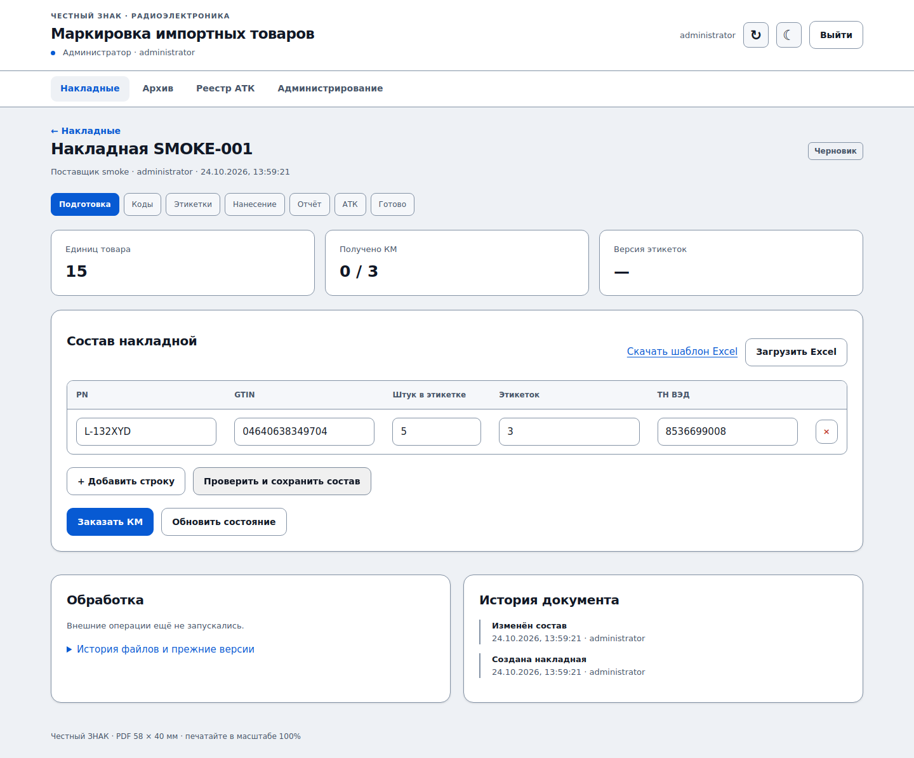

# marking-bm

Рабочее место бренд-менеджера для маркировки импортной радиоэлектроники: накладные, общий пул КМ, PDF 58×40 мм, отчёты о нанесении, АТК, согласуемые трансформации и итоговые Excel.

**В приложении нет деморежимов, фиктивных кодов и имитации успешных операций.** Интеграции обращаются к реальным СУЗ / True API. Подмены внешних ответов используются исключительно в `tests/`.

Реализация использует официальные схемы OMS Cloud 3.0.40 от 24.09.2026 и True API v747.0 от 21.10.2026. Отправка внешних операций по умолчанию выключена (`BM_ALLOW_EXTERNAL_WRITES=0`): очередь сохраняется, а рабочее место не выдаёт неподтверждённый результат за успех. Это блокировка отправки до настройки, а не другой режим приложения.

## Установка на Ubuntu

Требуется Python 3.12, корпоративный HTTPS, установленный шрифт DejaVu Sans и доступ VPS к СУЗ и ГИС МТ. Пример выполняет администратор VPS:

```bash
sudo useradd --system --home /var/lib/marking-bm --shell /usr/sbin/nologin markingbm
sudo git clone https://github.com/AlexSapronov/marking-bm.git /opt/marking-bm
cd /opt/marking-bm
sudo python3 -m venv .venv
sudo .venv/bin/pip install -r requirements-lock.txt
sudo install -d -o markingbm -g markingbm -m 700 /var/lib/marking-bm
sudo cp .env.example /etc/marking-bm.env
sudo chmod 600 /etc/marking-bm.env
.venv/bin/python scripts/password_hash.py
```

В `/etc/marking-bm.env` внесите полученный scrypt-хеш, URL приложения и сгенерированный отдельно случайный токен подписанта. Для генерации токена: `.venv/bin/python -c "import secrets;print(secrets.token_urlsafe(48))"`. Этот секрет нельзя использовать как пароль сотрудника или хранить в Git.

```bash
sudo cp deploy/marking-bm.service /etc/systemd/system/
sudo systemctl daemon-reload
sudo systemctl enable --now marking-bm
```

Добавьте `deploy/nginx.conf` в HTTPS-сервер корпоративного reverse proxy. Укажите тот же origin в `BM_PUBLIC_URL`. Порт 8010 слушает только localhost. Не открывайте его наружу; в systemd оставьте **один** worker. Серверу нужен доступ HTTPS к `markirovka.crpt.ru` и `suzgrid.crpt.ru`.

Файл `.env.example` предназначен для `EnvironmentFile` systemd. Приложение не загружает `.env` автоматически.

## Локальный запуск на Windows через WSL2

Можно запустить боевую версию на одном Windows-ПК: FastAPI + SQLite в WSL2, браузер и подписант КриптоПро/Рутокен в Windows, без VPS/Tailscale и без TLS-прокси. Сервер слушает строго `127.0.0.1:8010`; HTTP разрешён только для локального соединения. **При переходе с VPS обязательно остановите старую службу до миграции БД, чтобы не отправить существующий заказ КМ повторно.** Полные команды и безопасная миграция: [docs/WSL.md](docs/WSL.md).

## Первое подключение

1. Откройте `/admin`, войдите по отдельному паролю и создайте username сотрудников.
2. Заполните одну организацию, ИНН, OMS ID, omsConnection и шаблон 36 либо 37. Никакие вымышленные значения не подставляются. При необходимости задайте КПП/ФИАС места деятельности.
3. На Windows-ПК с установленными КриптоПро и Рутокеном выполните диагностику из [инструкции подписанта](docs/SIGNER.md). Укажите точный отпечаток сертификата в `BM_SIGNER_THUMBPRINT` на сервере и при запуске подписанта.
4. После проверки подключения включите отправку в защищённой конфигурации VPS (`BM_ALLOW_EXTERNAL_WRITES=1`) и перезапустите сервис. Само включение не создаёт заказы: операции возникают только из сохранённых действий пользователей и очереди авторизации.
5. В админке запросите обновление доступа ГИС МТ и СУЗ. Подписант получает задания, подписывает точные UTF-8 байты; токены принимает сервер. PIN вводится только локально средствами КриптоПро.
6. Проведите первую согласованную реальную операцию по [чек-листу приёмки](docs/ACCEPTANCE.md). **Во время разработки платные операции в продуктиве не выполнялись.**

## Что реализовано

- Русский интерфейс сотрудника, отдельная админка и серверные сессии. Username без пароля; административные права требуют отдельной проверки пароля. CSRF, ограничение попыток входа, проверка владельца документа и файла на сервере.
- Excel по фиксированному шаблону, предпросмотр и объединение совпадающих строк, глобальная привязка GTIN→ТН ВЭД, подтверждение нового PN и изменения общего количества.
- SQLite WAL, `BEGIN IMMEDIATE`, единый пул КМ между сотрудниками/поставщиками; сохраняются исходные коды, 20 символов serial, криптохвост и GS. Нет повторной покупки кодов ради другой разбивки.
- Отдельная эмиссия `IMPORT` / `paymentType: 1` только дефицита. Частичное получение КМ не открывает PDF. Потерянный ответ не вызывает слепой повтор.
- Векторный GS1 DataMatrix, отдельный многостраничный PDF на PN+количество+GTIN, один ZIP на накладную, неизменяемые версии назначений и файлов. После переразбивки отметка передачи сбрасывается.
- По одному отчёту на накладную; группы поставщиков независимы. АТК создаётся только после принятия всех отчётов группы. Внутри группы разделение по полному ТН ВЭД, полученный из ЧЗ 25-значный АТК, сумма AI 30 и два XLSX на поставщика.
- Дополнения к оформленным документам; их отчёты ожидают одобренного добавления в существующий АТК. Добавление/изъятие требуют согласования. Для повторного включения изъятого КМ нужны отдельное разрешение КМ и отдельное одобрение заявки.
- Долговечная очередь подписи, централизованный user-level PowerShell-подписант, журнал операций и квитанций, восстановление конкретного блока СУЗ в пределах ограничений СУЗ.
- Архив через шесть календарных месяцев, сохранение всех файлов в БД, консистентный backup/restore с проверкой связей и контрольных сумм.

## Роли пользователей

В админке каждому username назначается «Бренд-менеджер» или «Логист». Существующие пользователи при обновлении автоматически остаются бренд-менеджерами. Изменение роли завершает обычные сессии; административный вход по отдельному паролю сохраняется независимым.

Логисты видят общий реестр АТК всех сотрудников: поиск по коду/накладной, фильтры по поставщику, статусу, периоду, полному ТН ВЭД и архиву. Доступны состав АТК, актуальные и прежние версии АТК/RESULT и массовый ZIP без дублирования общих файлов поставщика. Заказ, редактирование, подпись и трансформации для них закрыты серверными проверками.

## Интерфейс



Скриншоты сняты с реально запущенного приложения в Chromium, без внешней отправки. Дополнительно: [список накладных](docs/screenshots/documents.png), [админка](docs/screenshots/admin.png), [реестр логиста](docs/screenshots/logistics.png), [тёмная тема](docs/screenshots/logistics-dark.png).

Интерфейс использует общий стиль `gis-trueapi` и `km-split`: синюю палитру, верхнюю панель, горизонтальную навигацию, одинаковые светлую/тёмную темы и контрастные таблицы.

## Проверки

```bash
pip install -r requirements-dev.txt
python -m pytest -q
python -m playwright install chromium
python tests/browser_smoke.py
```

Тесты API используют `httpx.MockTransport` и проверяют реальные клиенты запросов. Подмены находятся только в тестовых файлах. Браузерная проверка запускает обычное приложение с выключенной внешней отправкой, создаёт документ через UI и проверяет сохранение, фильтры и мобильную ширину. Декодирование DataMatrix проверяется ZXing из отрисованной страницы PDF.

## Резервная копия и восстановление

```bash
sudo -u markingbm /opt/marking-bm/.venv/bin/python /opt/marking-bm/scripts/backup.py \
  /var/lib/marking-bm/marking-bm.sqlite3 /var/lib/marking-bm/backups/2026-10-24.sqlite3
```

Скрипт использует SQLite Backup API, а не копирование файлов WAL. Все версии PDF/ZIP/Excel, снимки, квитанции и настройки организации находятся в той же транзакционной БД. Скрипт проверяет `integrity_check`, внешние ключи и SHA-256 всех файлов. Копируйте backup и его JSON-манифест на другой диск/сервер; автоматического удаления нет.

Восстанавливать только при остановленном сервисе, в **новый** файл:

```bash
sudo systemctl stop marking-bm
python scripts/backup.py /safe/backup.sqlite3 /var/lib/marking-bm/restored.sqlite3 --restore
```

Сохраните прежнюю БД и WAL/SHM отдельно, затем замените рабочую БД восстановленной, задайте владельца `markingbm` и права 600. `/etc/marking-bm.env` содержит секреты: храните его отдельно в принятом защищённом хранилище. Токены в `/var/lib/marking-bm/tokens.json` не входят в переносимую копию — после переноса обновите авторизацию через подписант. Не запускайте одновременно две копии восстановленной БД на одном доступе ЧЗ.

## Обновление

Сделайте backup, остановите сервис, обновите проверенную ветку/тег, установите зависимости, запустите сервис и проверьте `/health` и админку. Инициализация БД идемпотентна. Операции, прерванные в момент отправки/списания буфера, получают неизвестный результат и не отправляются автоматически повторно.

## Документация и границы проверки

- [Результат реализации и границы проверки](docs/IMPLEMENTATION.md)
- [Сотруднику](docs/USER.md)
- [Логисту](docs/LOGISTICS.md)
- [Администратору](docs/ADMIN.md)
- [Подписант на Windows](docs/SIGNER.md)
- [Схемы API и источники](docs/INTEGRATIONS.md)
- [Хранение, статусы и восстановление](docs/ARCHITECTURE.md)
- [Приёмка и первая реальная операция](docs/ACCEPTANCE.md)
- [Исходное ТЗ](docs/TASK.md): последующее указание владельца **исключает деморежимы**; это изменение имеет приоритет над пунктами исходного файла.

**Непроверенное:** доступ конкретной организации к API, настройки реального сертификата, требования PIN/касания и фоновая подпись на физическом Рутокене. В этой среде нет вашего Windows-ПК и ключа; доступность полностью автоматической подписи не заявляется до локального PoC. Реальные платные заказы, отчёты и АТК во время разработки не отправлялись. Поддерживаемые схемы подключены к реальным HTTP-клиентам; окончательная проверка конкретного продуктивного контура выполняется владельцем по чек-листу.
