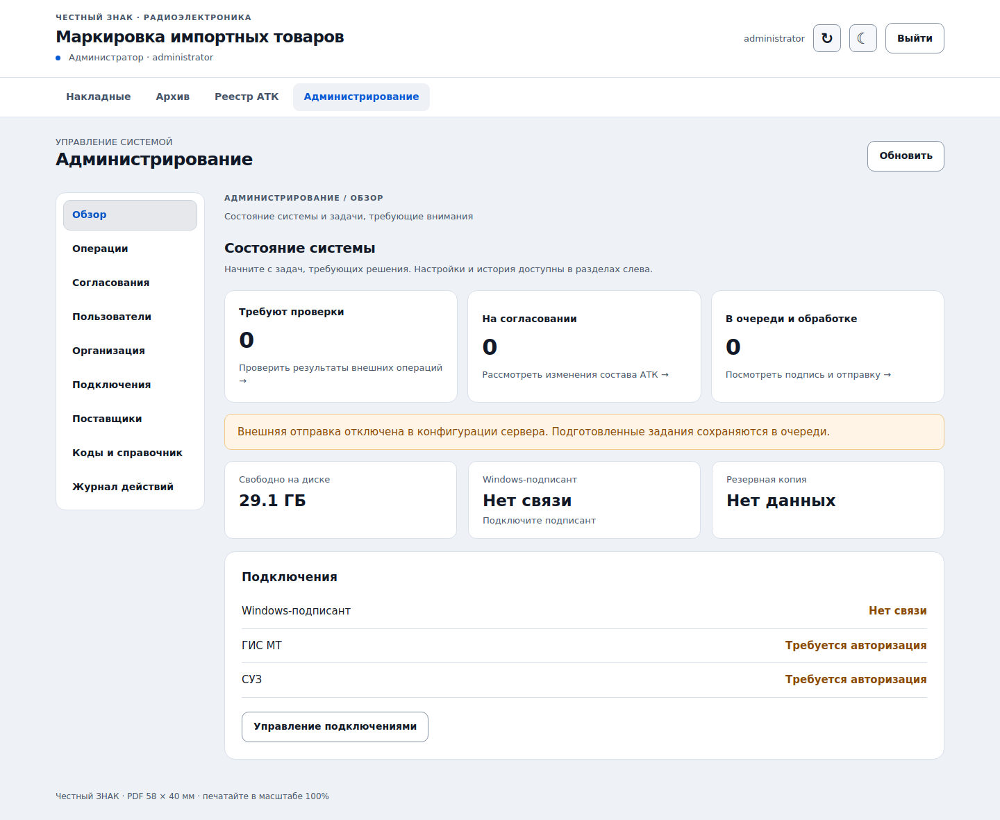

# Инструкция администратора

Вход `/admin` требует отдельного пароля. Вход под username `administrator` без этого пароля не даёт административных прав. Username сотрудников отражает выбранную учётную запись; достоверно установить физического человека при принятом входе без пароля нельзя.

## Навигация

Админка разделена на рабочие разделы. «Обзор» показывает задачи, требующие проверки, согласования, очередь, состояние подписанта, свободное место и последнюю резервную копию. Карточки задач ведут к соответствующему разделу; карточка проблем сразу включает отбор операций, требующих проверки.

- «Операции» — очередь подписи и внешних запросов, поиск, отбор проблемных, незавершённых или завершённых операций и действия по сверке результатов.
- «Согласования» — заявки на изменение состава АТК.
- «Пользователи» — поиск сотрудников, роли и доступ, добавление учётных записей.
- «Организация» — три группы настроек: реквизиты, место деятельности и эмиссия в СУЗ.
- «Подключения» — авторизация ГИС МТ/СУЗ и сведения о подписанте.
- «Поставщики», «Коды и справочник», «Журнал действий» — отдельные разделы для справочников и истории.

Выбранный раздел сохраняется в адресе страницы и открывается после перезагрузки. Переключение разделов само по себе не сохраняет настройки и не очищает введённые значения. Для сохранения используйте кнопку формы; обновление страницы заново загружает данные с сервера.

## Настройка

- Создавайте/отключайте username и назначайте роль «Бренд-менеджер» либо «Логист». Для нового пользователя выберите роль в форме добавления; для существующего — в его строке. Отключение и смена роли аннулируют обычные серверные сессии пользователя.
- Логистам доступен общий реестр АТК всех сотрудников и скачивание АТК/RESULT, включая архив и предыдущие версии. Создание накладных, эмиссия, отчёты и трансформации им недоступны. Роль не выбирается самим пользователем при входе. Все существующие username при миграции сохраняют роль бренд-менеджера.
- Настройте организацию, OMS ID/omsConnection, шаблон 36/37 и место деятельности. Нельзя сменить ИНН организации при уже существующих документах. Изменение подключения запрещено, пока есть незавершённые операции.
- Пароль хранится как scrypt-хеш во внешнем файле конфигурации VPS. Токен подписанта — отдельный случайный секрет. Отпечаток сертификата задаётся на VPS и на Windows.
- Обновляйте доступ ГИС МТ/СУЗ кнопками админки; подпись выполняет Windows-ПК. Фоновый обработчик также готовит обновление перед истечением полученных токенов. Если срок не возвращён ЧЗ, обновление планируется раньше типового окончания доступа. При выключенном подписанте задания сохраняются.
- При исчерпании диска новые операции нужно остановить и освободить место вне архива приложения. История автоматически не удаляется.

## Справочники

Поставщика можно переименовать или объединить с другим. Объединение сохраняет исходные партии, операции, АТК и прежние файлы как историю. Документы переводятся на канонический ID поставщика, будущие партии группируются по нему. Исторические внешние операции не переписываются и не отправляются заново. После слияния проверьте активные партии: ранее зафиксированные независимые группы сохраняют исходный состав.

Исправление глобальной привязки GTIN→ТН ВЭД требует причины и фиксируется в журнале. Старые документы/КМ/файлы остаются неизменными. Перед новым заказом используется актуальный справочник; старые несовместимые строки нужно проверить и исправить явно.

## Ошибки и неизвестный результат

В журнале нет кнопки слепой повторной отправки.

- «Проверка перед отправкой не пройдена»: внешняя мутация ещё не начиналась. Исправьте доступ/сведения и нажмите «Проверить состояние». Обработчик повторит проверки перед первой отправкой.
- Известен внешний ID: кнопка «Проверить состояние» выполняет безопасное чтение результата, не создавая новый заказ/отчёт/АТК.
- Неизвестный результат без ID: найдите запрос в ЛК, сверьте `productionOrderId`, время, товарную группу, GTIN, количество и состав. Только после однозначной сверки привяжите найденный ID с причиной. Если однозначность не установлена — остановитесь и обратитесь в поддержку ЧЗ.
- Потеря ответа на получение КМ: «Восстановить конкретный блок» показывает блоки этого заказа/GTIN, появившиеся после сохранённого снимка. Выберите подтверждённый блок. Используется официальный повтор конкретного блока, а не исходный расходующий буфер запрос. СУЗ допускает это только до закрытия заказа и при других ограничениях руководства. При неоднозначности или закрытом заказе требуется сверка с поддержкой ЧЗ; новые платные КМ автоматически не заказываются.
- Ошибка PDF: исходный блок и сами КМ уже сохранены отдельно. Сотрудник может исправить слишком длинный PN, новая эмиссия для замены макета не нужна.

Квитанции и исходные ответы хранятся в БД. Не выгружайте БД в общие чаты: она содержит полные КМ и подписи. Токены хранятся отдельно в `tokens.json` с правами 600.

## Согласования

При рассмотрении заявки видны исходный АТК и конкретные КИ, PN, количества. Одобрение/отклонение обязательно сопровождается причиной. Перед фактической отправкой сервер снова проверяет состояния, собственника и вложенность в ЧЗ.

Изъятому КМ требуется отдельное разрешение на повторный подбор. Это действие само не согласует его последующее добавление: для него создаётся и рассматривается новая заявка. Полное расформирование АТК отсутствует; изъять весь состав одной заявкой нельзя.

## Резервные копии

Запускайте `scripts/backup.py` по расписанию средствами VPS. БД включает файлы и их версии, поэтому backup согласован с ними транзакционно. Проверяйте отметку последнего backup в админке. Переносите копии с единственного диска VPS на другой носитель.

Отдельно защищённо сохраняйте `/etc/marking-bm.env`. Для восстановления остановите сервис и используйте `--restore` в новый файл; скрипт проверит структуру, связи и контрольные суммы. Повторите авторизацию после переноса. Не запускайте клон приложения параллельно с исходным сервером на восстановленной базе.
